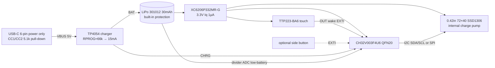

# Code Rain Screen Ring v1: Design Notes

> Labels: **[datasheet]** = taken from an opened datasheet or product page; **[estimate]** = my assumption or estimate, to be measured on a prototype.

## 1. Look and positioning (distinct from the Daniel Idle ring)
- Daniel Idle "Digital Rain Ring": electroplated 925-silver signet ring, face about 21×18 mm, square bezel and a C-shaped open band (as reported by designboom).
- Our v1: **chamfered octagonal face 17 × 15.5 mm** (smaller, with a chamfered-octagon outline), a 0.8 mm bevelled step on top plus a 0.25 mm engraved "mech frame" line, a **12-facet band (cyber facets)**, and 3 vertical grooves on the side marking the touch area. Suggested materials: black resin, later CNC titanium or aluminium; no silver-signet styling.

## 2. Key dimensions (CAD parameters, editable at the top of cad/ring.py)
| Item | Value |
|---|---|
| Face outline | 17.0 (along finger) × 15.5 (across) mm, chamfer 2.2 |
| Face height (bottom of lid → top) | 9.5 mm |
| Top above top of finger | **≈9.8 mm** (lid 0.3 mm from the finger) |
| Display window | 10.6 × 6.6 mm (OLED active area 10.196×6.18 [datasheet]) |
| Cover pocket | 12.6 × 8.6 × 0.7 mm (0.5 mm green acrylic/sapphire + double-sided tape) |
| OLED pocket | 12.3 × 11.3 × 1.35 (panel 12×11×1.227 [datasheet]) + 1 mm FPC bend slot |
| Inner cavity | 13.2 × 12.6 × 6.55 mm (PCB 0.8 + USB-C zone 3.2 + battery 3.0 + clearance) |
| Bottom lid | 13.5 × 12.9 × 0.9 mm, concave to fit the finger, UV glue / snap fit |
| USB-C opening | 9.2 × 3.4 mm, R1.3, at the −X end (toward fingertip or back of hand, optional) |
| Side button slot (optional) | 2.4 × 1.4 mm, +Y side |
| Wire channel | −Y inner wall 9 × 0.9 mm (battery wire / touch electrode wire) |
| Thinnest walls | side wall ~1.25 mm, top frame around the cover ~1.4 mm, band 1.6 mm (requirement ≥0.8–1.0) |
| Band | nominal ID 20.6 (≈US 11), width 5.5 mm, 7 mm opening at the bottom |
| Overall envelope | 17 × 23.8 × 32 mm |

**Sizing (honest note):** the open band adjusts by flexing. Ordinary (brittle) resin only deforms reliably by about ±0.5 mm in diameter, so **one size covering US 9–13 (18.9–22.2 mm) is not realistic in ordinary resin**. Therefore: (1) the CAD also exports ID 18.9 and 22.2 versions; (2) print in tough / PP-like resin or MJF nylon; (3) a production version could use swappable bands (face + 3 band sizes) or a metal open band. Decision pending (Dresden).

## 3. Internal stack (top to bottom; see renders section_x0.png, section_y0.png, exploded.png)
```
z (mm, finger centre = 0)
20.1  -- top face / bevelled frame
19.4  -- 0.5 green cover (0.7 pocket)
18.2  -- OLED 12x11x1.23 (FPC folds from the +X end to the PCB below)
17.8  -- USB-C top (mid-mount, slot in PCB)
16.2  -- PCB top (0.8 mm, 13.0x12.4, parts on the bottom / same layer as USB-C)
14.6  -- USB-C bottom
14.5  -- battery 301012 (3.0x10.2x12.2)
11.5  -- top of bottom lid
10.6  -- bottom of lid (touches finger)
10.3  -- top of finger (ID 20.6)
```
Note: a 301012 with a protection board (PCM) can be up to 14 mm long [datasheet, DNK] while the cavity is only 13.2 mm, so either pick a version without leads / with the PCM folded to the side, or lengthen the cavity to 15 mm (face becomes 18.8 mm). To be confirmed.

## 4. Block diagram

- Power switch: none in v1; standby ~20–30 µA. A solder-jumper pad on the PCB can serve as shipping mode.
- Charge current capped at 0.5C: TP4054 I = 1000×1V/RPROG [datasheet]; 15 mA → RPROG ≈ 66 kΩ; full charge about 2–2.5 h [estimate].
- The LDO could be dropped: CH32V003 runs from 2.8–5.5 V and can sit directly on the battery, but the OLED logic voltage needs confirming (SDO7240 lists 3.0 V typical). v1 keeps the LDO for safety.

## 5. Firmware concept (72×40 code rain + sleep/wake)
- Frame buffer 72×40/8 = 360 bytes; the CH32V003's 2 KB RAM is enough.
- Font: custom 3×5 or 4×6 pixel katakana/digit glyphs (about 12 columns × 6–8 rows). One "drop" struct per column: head y, speed (1–3 levels), length 4–10, glyph seed. Head fully lit; the tail fades via **dithering / sparse pixels** (mono panel, no greyscale), or a global "breathing" with the SSD1306 contrast command.
- 15–20 fps; each frame sends 360 B over 400 kHz I2C ≈ 8 ms; the MCU sleeps (WFI) on a timer the rest of the time.
- State machine: `STANDBY →(touch/button EXTI)→ init OLED (0xAF) → play 12 s (10–15 s constant) → 0xAE display off + charge pump off (0x8D,0x10) → MCU standby`.
- While charging (CHRG low): optional progress bar or silent; v1 suggests silent ("code rain only").
- Low battery (<3.4 V): flash "LOW" once on wake, or stay dark (TBD).
- Prototype the animation on an ESP32-C3 board with Arduino + U8g2 (`U8G2_SSD1306_72X40_ER_F_HW_I2C`), then port to CH32V003 (ch32fun / MounRiver).

## 6. Battery life estimate
Datasheet currents: CH32V003 standby 9.0–10.5 µA @3.3 V; TTP223-BA6 low-power mode 1.5 µA typ; XC6206-G Iq 1 µA; SSD1306 sleep ≤15 µA (modules typically 1–5 µA); one SSD1306 module draws 7.5–15.8 mA on VCC when running (figure from a 128×64 module).
[estimate] The 72×40 panel is about 1/3–1/4 the area of 128×64 and code rain lights about 20–30% of pixels, so **OLED ≈ 3–5 mA**; MCU at 8–24 MHz with sleep between frames averages **~1–1.5 mA**. Usable capacity 30 mAh × 85% ≈ **25.5 mAh**.

| Scenario | Average current | Runtime |
|---|---|---|
| Pure standby (all asleep) | 10.5+1.5+1+5 (OLED sleep) + ~2 (charger/leakage) ≈ **20 µA** (pessimistic 30 µA) | 25.5/0.02 ≈ 1275 h ≈ **53 days** (pessimistic 35) |
| Always on, looping | 4.5–6 mA (pessimistic 10 mA) | **4.3–5.7 h** (pessimistic 2.5 h) |
| Tap-to-wake 30×/day × 12 s | 30×12/3600×5.5 = 0.55 mAh + standby 0.48 mAh ≈ 1.0 mAh/day | **≈ 25 days** |
| Tap-to-wake 100×/day × 12 s | 1.83 + 0.48 ≈ 2.3 mAh/day | **≈ 11 days** |

Conclusion: tap-to-wake comfortably gives "charge once a week"; always-on lasts only half a day and is not recommended as the v1 default.

## 7. Prototype roadmap
1. **Test board:** ESP32-C3 0.42" OLED dev board (~25×20.5 mm, OLED on GPIO5/6 I2C) [product page]. Validate the animation look, font, brightness / green cover effect and the 12 s wake logic. This board has Wi-Fi/BLE and is **for bench testing only**.
2. **Shell sample:** print the STLs here on an 8K SLA printer (tough resin), fit the panel from the ESP32 board + a 301012 battery + jumper wires, and test fit and size.
3. **Custom PCB v0.1:** 13×12.4 mm, 2-layer, 0.8 mm; CH32V003 + TP4054 + XC6206 + TTP223 + mid-mount USB-C; 5 pcs assembled at JLC.
4. **Integrated prototype:** calibrate battery life (replace section 6 estimates with measured current), temperature rise, charging.
5. **Compliance:** no radio at all, so in the US only FCC Part 15 Subpart B (unintentional radiator, supplier's declaration SDoC) applies; no Part 15C certification and no FCC ID. CE (EMC), UN38.3 battery transport and RoHS still apply.

## 8. Chinese marketplace research (what could be found)
- Web search found no clear listing on Taobao, Xianyu or Xiaohongshu of a "code rain OLED ring" like Daniel Idle's; Taobao results were mostly counter-screen rings, NFC rings and page-turner remote rings (e.g. a "new OLED colour-screen smart ring ... counter" at about ¥149).
- Limitation: these platforms require login and block scraping, so **we cannot confirm nobody sells one**. Suggest searching manually in the apps for "code rain ring", "Matrix ring screen" or "digital rain ring OLED".

## 9. Decisions pending (Dresden)
1. Sizing: one-size tough-resin open band vs 3 swappable band sizes vs a metal band.
2. Wake method: capacitive touch (no hole, more sweat-proof) vs a physical side button (more reliable, needs a hole). The CAD keeps both.
3. Green: green filter cover (stock white panel) vs a factory-custom green OLED (none in stock; MOQ to be asked).
4. The 9.8 mm face height is tall: a thinner 201012-class battery (≈2 mm, about half the capacity) would bring it down to ~8.8 mm.
5. USB-C direction: −X (toward fingertip) or toward the back of the hand; whether a power switch / shipping mode is needed.
6. Shell material: after the resin prototype, CNC aluminium/titanium, or keep resin + paint.
