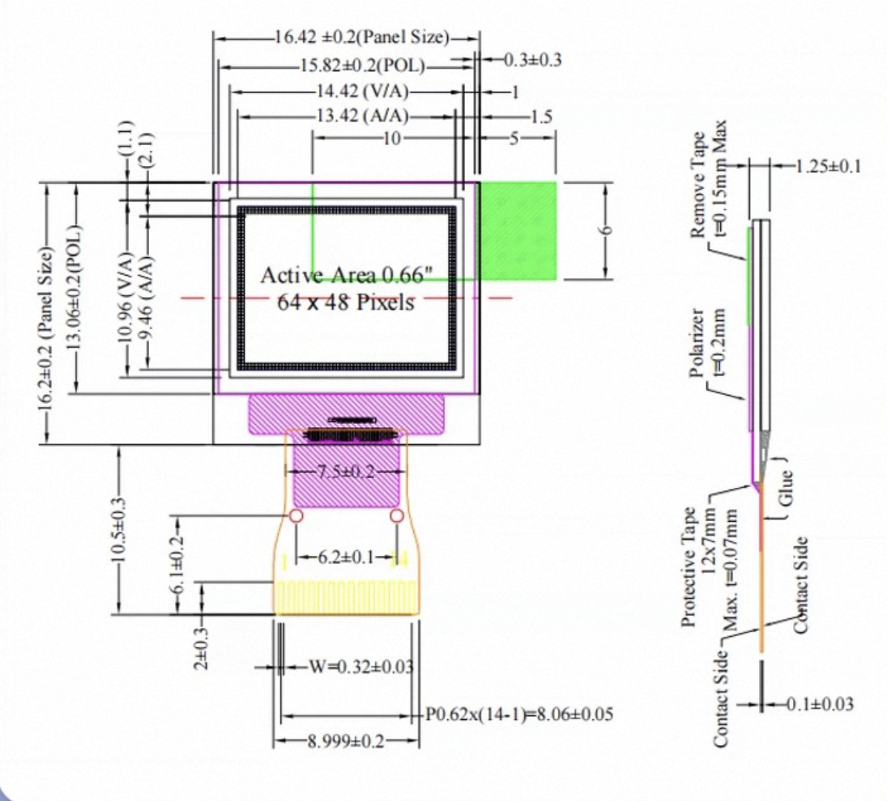
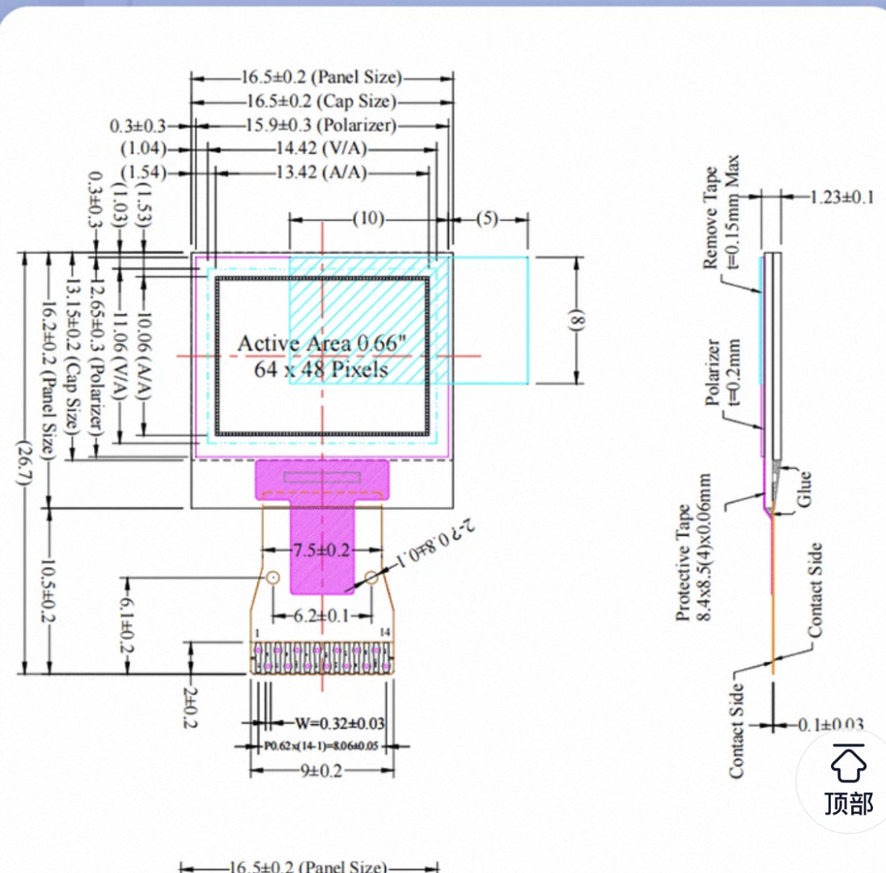
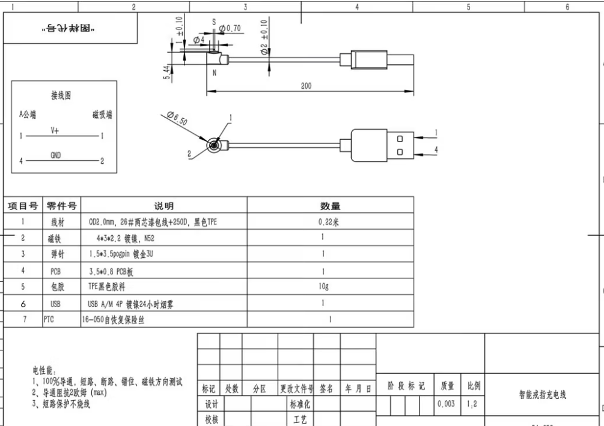
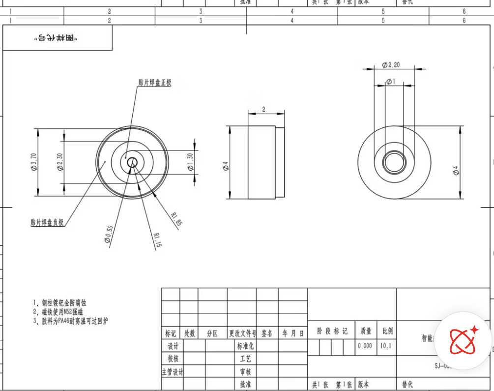

# 零件清单与精确尺寸 / Parts, BOM & Dimensions

> 所有尺寸单位 mm。**以本仓库 CAD 脚本 (`cad/ring_v10.py`) 与 `hardware/*/v10_*_checks.json` 为准。** 淘宝/拼多多商家图只作参考，很多是手机截图、比例不准、公差写得粗，见每项的"商家数据问题"。

## 1. BOM（当前原型方案）

| # | 零件 | 规格 / 型号 | 数量 | 来源 | 备注 |
|---|---|---|---|---|---|
| 1 | 金属外壳（一体） | v10 shell, M 或 L（`hardware/M|L/v10_*_shell.step`） | 1 | 珠光金属3D打印 | 最小金属壁厚 0.5 |
| 2 | 金属盖条 | 0.5 厚，宽 2.9；M 14.31×2.9，L 16.01×2.9（展开，见 `*_strip_flat.dxf`） | 1 | 同上 / 钢片切割 | 弯成内圈半径后胶粘入 3.0×0.5 槽 |
| 3 | 盖板玻璃 | 0.4 厚；M 17.25×12.8；L 18.8×13.9（落在 0.3 台阶上） | 1 | 淘宝定制 | 透明=白色显示；绿色印刷层=绿色显示（见 `*_glass_outline.dxf`） |
| 4 | OLED 屏 | M：0.66" 标准 64×48 (16.5×16.2)；L：大号 0.66" 18.46(Y)×18.1(X)×1.25 | 1 | 淘宝 | 见 reference/crops |
| 5 | 主控 MCU | ATtiny1616-MNR（VQFN-20 3×3） | 1 | LCSC C507118 | 薄型替代 CH32V003F4U6 (C5299908) |
| 6 | 加速度计（敲击唤醒） | SC7A20HTR（LGA-12 2×2） | 1 | LCSC C19274408 | 薄型替代 LIS2DW12TR (C189624) |
| 7 | 充电 IC | TP4054 / 薄型 BQ24040DSQR (C81080) | 1 | LCSC | |
| 8 | 保护 / LDO | AP6683 (C2849565)；TPS7A0530PDQNR (C2871471) | 各1 | LCSC | |
| 9 | 电池 | 020815 锂聚合物（2×8×15）直立，两颗，顶住头部顶面 | 2 | 淘宝 | 见 reference/seller/a.png, c1.jpg, c2.png |
| 10 | 磁吸充电座 | WIRE 4mm 圆形磁吸母座 Φ4×2 | 1 | 拼多多 / WIRE 磁吸 | 位于内圈底部 |
| 11 | FPC 排线 | ≤0.2 厚，宽 ≤2.2 | 1 | 定制 | 头部 → 充电座 |
| 12 | PCB | 0.4 厚 FR4 / 柔板，元件层 ≤0.85 | 1 | 嘉立创 | |
| 13 | 环氧胶 | 透明/金属色 AB 胶 | — | | 填平 0.25 深槽与充电座旁缝 |

详细的薄型器件比较见 [thin_bom.md](thin_bom.md)；电池方案见 [thin_battery.md](thin_battery.md)。

## 2. 我们使用的精确尺寸（v10）

| 项目 | M | L |
|---|---|---|
| 内径 ID | 19.4 | 21.0 |
| 外半径 / 指圈 | 11.2 / 1.5 实心金属 | 12.0 / 1.5 实心金属 |
| 头部 宽×长×厚 | 22.4×17.5×4.15 | 24.0×18.8×4.15 |
| 窗口 | 16.8×12.2 | 18.2×13.3（边框 左右2.9 / 上下2.75） |
| 玻璃 | 17.25×12.8×0.4 | 18.8×13.9×0.4，0.3 台阶 |
| OLED | 0.66" 标准 16.5×16.2 | 0.66" 大号 18.46×18.1×1.25 |
| 叠层 Z（M，自内圈底部算起） | 元件 10.70–11.55，PCB 11.55–11.95，OLED 11.95–13.40，胶 0.05，玻璃 13.45–13.85，顶面 14.35 | 同结构 |
| 电池 | 2× 020815 直立 (2×8×15) 顶住头顶 | 同 |
| 盖条（展开） | 14.31×2.9×0.5，35.3°–117.7° | 16.01×2.9×0.5，35.3°–120.6° |
| 环氧区 A（0.25 深槽，电池角处） | 118°–135° | 120.9°–133.4° |
| 环氧区 B（充电座旁） | 11.6°–35° | 10.7°–35° |
| 排线过孔（头部底板） | y=−7.5 | y=−8.3 |
| 充电垫 | 全宽内凸，峰高 1.0，两侧各 35° 过渡，0.4 圆角 | 同 |
| 充电座 | Φ4×2，内圈底部 | 同 |

角度从底部 (−Z) 向 −Y 方向测量。最小壁厚（来自 checks JSON）：电池角到内圈 M 0.78 / L 1.10；电池到排线槽 0.53 / 0.85；充电座背壁 0.50 / 0.50。

## 3. 商家图纸截取（reference/crops）

| 截图 | 内容 | 商家数据问题 |
|---|---|---|
|  `oled066_std_16.42_structure.png` | 0.66" 64×48 OLED 结构图（面板 16.42±0.2 × 16.2±0.2，AA 13.42×10.06） | 手机截图分辨率低；面板公差 ±0.2；FPC 弯折后长度未给出。我们按 16.5×16.2 建模（取上限）。 |
|  `oled066_16.5_structure.png` | 另一家 0.66" 结构图（面板 16.5±0.2，Cap 16.5±0.2，偏光片 15.9±0.3，厚 1.23±0.1） | 两家面板尺寸不一致（16.42 vs 16.5）；厚度 1.23 未含背胶。L 用的大号屏 18.46×18.1 无完整图纸，数据来自商家口述。 |
|  `magnet_4mm_cable_assembly.png` | WIRE 4mm 磁吸线组装图与 BOM 表 | 文字很小难以辨认，线长/针脚定义仅参考。 |
|  `magnet_4mm_socket_dims.png` | 4mm 磁吸母座尺寸（Φ4 外径） | 高度与焊盘尺寸模糊；我们按 Φ4×2 建模并留 0.5 背壁，**到货后需实测**。 |

原始商家图（完整截图）在 `reference/seller/`。电池照片 (a / c1 / c2) 是实物图，没有尺寸图，规格按型号 020815 = 2×8×15。
