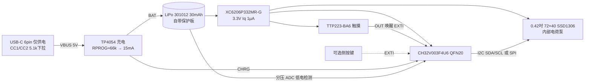

# 代码雨 / Code Rain 屏幕戒指 v1 设计说明

> 标注规则：**[数据手册]** = 来自已打开的数据手册/商品页；**[估算]** = 我的假设或估算，需要样机实测。

## 1. 外观定位（避开 Daniel Idle 款）
- Daniel Idle "Digital Rain Ring"：925 银电镀印章戒、正面约 21×18 mm、方形边框 + C 型开口戒圈（designboom 报道）。
- 我们 v1：**八角形切角面板 17 × 15.5 mm**（比对方小、轮廓是切角八边形），顶部 0.8 mm 斜切台阶 + 一圈 0.25 mm 刻线“机甲框”，戒圈为 **12 面多棱切面（cyber 棱角）**，侧面 3 条竖向刻纹标示“轻触区”。材质建议黑色树脂/后期 CNC 钛或铝，不做银色印章风格。

## 2. 关键尺寸（CAD 参数，cad/ring.py 顶部可改）
| 项目 | 数值 |
|---|---|
| 面板外形 | 17.0（沿手指）× 15.5（横向）mm，切角 2.2 |
| 面板高度（底盖底面→顶面） | 9.5 mm |
| 顶面高出手指顶面 | **≈9.8 mm**（底盖距手指 0.3 mm） |
| 显示窗 | 10.6 × 6.6 mm（OLED 可视区 10.196×6.18 [数据手册]） |
| 盖板凹槽 | 12.6 × 8.6 × 0.7 mm（放 0.5 mm 绿色亚克力/蓝宝石 + 双面胶） |
| OLED 槽 | 12.3 × 11.3 × 1.35（屏 12×11×1.227 [数据手册]）+ 1 mm FPC 折弯槽 |
| 内腔 | 13.2 × 12.6 × 6.55 mm（PCB 0.8 + Type-C 区 3.2 + 电池 3.0 + 间隙） |
| 底盖 | 13.5 × 12.9 × 0.9 mm，内凹贴合手指，UV 胶/卡扣固定 |
| USB-C 开口 | 9.2 × 3.4 mm，R1.3，位于 -X 端（朝手背/指尖方向可选） |
| 侧按键槽（可选） | 2.4 × 1.4 mm，+Y 侧 |
| 走线槽 | -Y 内壁 9 × 0.9 mm（电池线/触摸电极线） |
| 最薄壁 | 侧壁 ~1.25 mm，盖板周围顶框 ~1.4 mm，戒圈 1.6 mm（≥0.8–1.0 要求） |
| 戒圈 | 内径 20.6（≈US 11）名义，宽 5.5 mm，底部开口 7 mm |
| 整体外包络 | 17 × 23.8 × 32 mm |

**调节方式（诚实说明）**：开口戒圈靠弹性张开/收拢。普通树脂（脆）只能可靠变形约 ±0.5 mm 直径，**单一尺寸覆盖 US 9–13（18.9–22.2 mm）对普通树脂不现实**。所以：①CAD 已额外导出 ID 18.9 / 22.2 两个尺寸；②建议打印用 Tough/类 PP 韧性树脂或尼龙 MJF；③正式版可考虑可替换戒圈（面板+3 个尺寸圈）或金属开口圈。这是待 Dresden 决定的点。

## 3. 内部堆叠（自上而下，见 renders/section_x0.png、section_y0.png、exploded.png）
```
z(mm, 手指中心为0)
20.1  ── 顶面 / 斜切框
19.4  ── 0.5 绿色盖板（凹槽 0.7）
18.2  ── OLED 12×11×1.23（FPC 从 +X 端折到下方 PCB）
17.8  ── Type-C 顶（中置 mid-mount，PCB 开槽）
16.2  ── PCB 顶面（0.8 mm，13.0×12.4，元件在底面/与 Type-C 同层）
14.6  ── Type-C 底
14.5  ── 电池 301012（3.0×10.2×12.2）
11.5  ── 底盖顶面
10.6  ── 底盖底面（贴手指）
10.3  ── 手指顶面（ID 20.6）
```
注意：带保护板（PCM）的 301012 实际长度可达 14 mm [数据手册 DNK]，内腔只有 13.2 mm → 需选“无引线/保护板侧折”版本或把内腔加长到 15 mm（面板变 18.8 mm）。待确认。

## 4. 电路框图

- 电源开关：v1 不设开关，靠待机 ~20–30 µA；运输时可在 PCB 留焊盘跳线。
- 充电电流按 0.5C 上限：TP4054 I = 1000×1V/RPROG [数据手册]，15 mA → RPROG ≈ 66 kΩ；满充约 2–2.5 h [估算]。
- 可省 LDO：CH32V003 供电 2.8–5.5 V，可直接接电池；但 OLED 逻辑电压需要确认（SDO7240 标 3.0 V 典型）。v1 保留 LDO 更稳。

## 5. 固件思路（72×40 代码雨 + 睡眠唤醒）
- 帧缓冲 72×40/8 = 360 字节，CH32V003 2 KB RAM 足够。
- 字体：3×5 或 4×6 像素自制“片假名/数字”字形（约 12 列 × 6–8 行字符）；每列一个“雨滴”结构：头部 y、速度（1–3 档）、长度 4–10、字符种子。头部全亮，尾部用**抖动/间隔点亮**模拟渐暗（单色屏无灰度），或用 SSD1306 对比度命令做全局呼吸。
- 帧率 15–20 fps；每帧 I2C 400 kHz 传 360 B ≈ 8 ms，其余时间 MCU 进 Sleep（WFI）等定时器。
- 状态机：`STANDBY →(触摸/按键 EXTI)→ 初始化 OLED(0xAF) → 播放 12 s(10–15 可调常量) → 0xAE 显示关 + 电荷泵关(0x8D,0x10) → MCU Standby`。
- 充电中（CHRG 低）：可选显示进度条或静默；v1 建议静默以“只播代码雨”。
- 低电（<3.4 V）：唤醒后只闪一下“LOW”或直接不亮（待定）。
- 原型阶段在 ESP32-C3 板上用 Arduino + U8g2（`U8G2_SSD1306_72X40_ER_F_HW_I2C`）快速验证动画，再移植到 CH32V003（ch32fun / MounRiver）。

## 6. 续航估算
数据手册电流：CH32V003 Standby 9.0–10.5 µA @3.3V；TTP223-BA6 低功耗模式 1.5 µA 典型；XC6206-G Iq 1 µA；SSD1306 睡眠 ≤15 µA（模块常见 1–5 µA）；某 SSD1306 模块工作时 VCC 7.5–15.8 mA（该数据来自 128×64 模块）。
[估算] 72×40 屏面积约为 128×64 的 1/3–1/4，代码雨点亮率约 20–30%，**OLED 取 3–5 mA**；MCU 8–24 MHz 带帧间睡眠平均 **~1–1.5 mA**。可用容量取 30 mAh × 85% ≈ **25.5 mAh**。

| 场景 | 平均电流 | 续航 |
|---|---|---|
| 纯待机（全睡） | 10.5+1.5+1+5(OLED睡) +~2(充电IC/漏电) ≈ **20 µA**（悲观 30 µA） | 25.5/0.02 ≈ 1275 h ≈ **53 天**（悲观 35 天） |
| 常亮循环播放 | 4.5–6 mA（悲观 10 mA） | **4.3–5.7 h**（悲观 2.5 h） |
| 轻触唤醒 30 次/天 × 12 s | 30×12/3600×5.5 = 0.55 mAh + 待机 0.48 mAh ≈ 1.0 mAh/天 | **≈ 25 天** |
| 轻触唤醒 100 次/天 × 12 s | 1.83 + 0.48 ≈ 2.3 mAh/天 | **≈ 11 天** |
结论：轻触唤醒方案“一周一充”很稳；常亮只够半天，不建议作为 v1 默认。

## 7. 原型路线
1. **验证板**：ESP32-C3 0.42" OLED 开发板（~25×20.5 mm，OLED 在 GPIO5/6 I2C）[商品页]。验证：动画观感、字体、亮度/绿色盖板效果、12 s 唤醒逻辑。注意：此板有 Wi‑Fi/BLE，**仅用于台面验证**（无线关闭也照样是射频模组）。
2. **外壳打样**：本目录 STL 用 8K 光固化树脂打（Tough 树脂），装 ESP32 板拆下来的屏 + 301012 电池 + 飞线，测佩戴/尺寸。
3. **定制 PCB v0.1**：13×12.4 mm 双层 0.8 mm，CH32V003 + TP4054 + XC6206 + TTP223 + Type-C mid-mount；JLC 贴片 5 片。
4. **集成样机**：校续航（实测电流替换第 6 节估算）、温升、充电。
5. **合规**：无任何无线电 → 美国 FCC 只需 Part 15 Subpart B 非故意辐射体（供应商自我声明 SDoC），不需 Part 15C 认证、无需 FCC ID；成本和周期大幅降低。仍需 CE(EMC)/UN38.3 电池运输、RoHS 等。

## 8. 中国平台调研（本次能查到的）
- 网页搜索未找到淘宝/闲鱼/小红书上与 Daniel Idle 同款“代码雨 OLED 戒指”的明确在售链接；淘宝结果多是计数器屏幕戒指、NFC 戒指、翻页遥控戒指（如“新款OLED彩屏智能戒指…计数器”约 ¥149）。
- 局限：淘宝/闲鱼/小红书需登录且屏蔽抓取，**无法确认“已经有人在卖”**。建议用 App 搜“代码雨戒指 / 黑客帝国 戒指 屏幕 / 数字雨 戒指 OLED”人工核实。

## 9. 待 Dresden 决定
1. 尺寸方案：单码韧性树脂开口圈 vs 3 个尺寸可换圈 vs 金属圈。
2. 唤醒方式：电容触摸（无开孔、更防汗）vs 侧面实体按键（更可靠、需开孔）——CAD 两者都留了。
3. 绿色：绿色滤光盖板（现成白屏）vs 找厂定制绿色发光 OLED（未找到现货，MOQ 待问）。
4. 面板高度 9.8 mm 偏高：可换 201012 级更薄电池（≈2 mm，容量约减半）把高度降到 ~8.8 mm。
5. USB-C 口朝向：-X（指尖方向）还是手背方向；以及是否需要电源开关/运输模式。
6. 外壳材质：树脂原型后用 CNC 铝/钛 还是继续树脂+喷涂。
